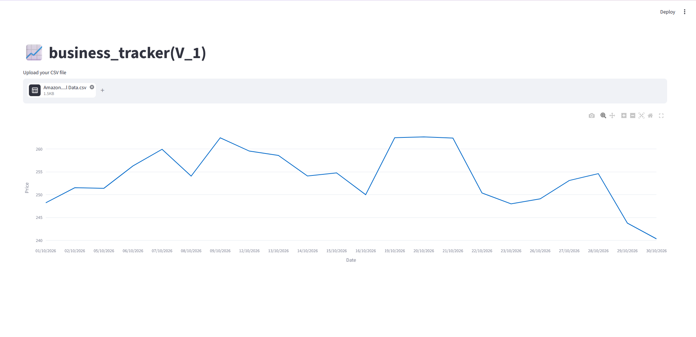

# 📈 business_tracker(V_1)
This is a clean web tool to help visualise stock prices

## Features
*Upload standard stock history CSV files
*Automatically sorts data from oldest to newest
*Formats dates into day/month/year
*Interactive line graph

## Tech Stack
*Python
*Pandas
*Streamlit
*Plotly express

## How to Download and Run Locally

### Prerequisites
Make sure you have **Python 3.11.9** and **Git** installed on your computer.

### Setup Commands
Open your terminal (or Command Prompt) and run these three lines:

1. **Clone the project folder:**
   ```bash
    git clone https://github.com/HarryHumphries2607/business_tracker-V_1.git
    cd business_tracker-V_1
   ```

2. **Install the dependencies:**
   ```bash
   pip install -r requirements.txt
   ```

3. **Launch the web application:**
   ```bash
   streamlit run app.py
   ```

# Screenshot

